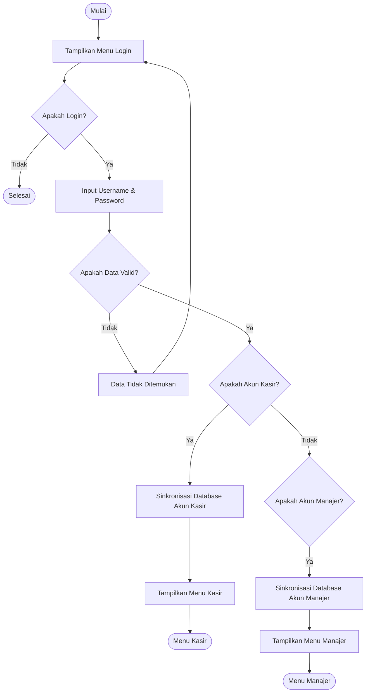
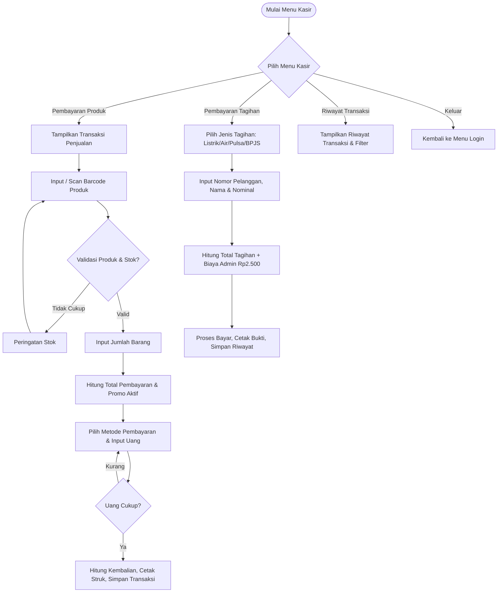
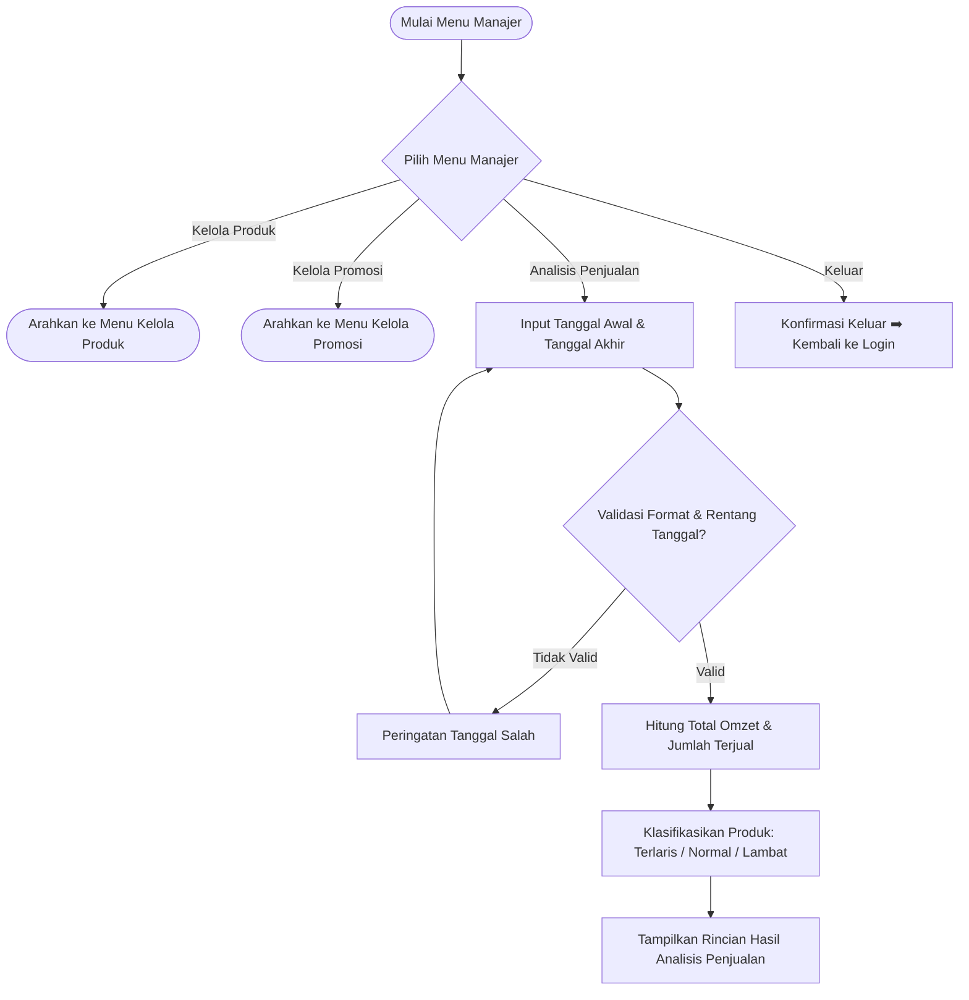
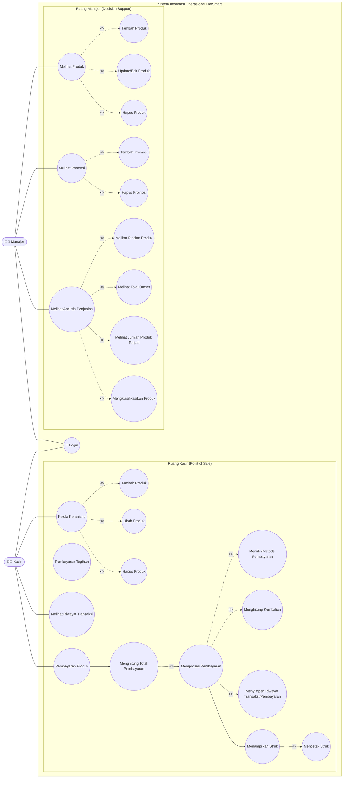

<div align="center">

# 🛒 FlatSmart
### *Sistem Informasi Operasional Minimarket & Decision Support System*

[](https://www.oracle.com/java/)
[](https://docs.oracle.com/javase/8/docs/technotes/guides/swing/)
[](https://netbeans.apache.org/)
[](https://www.mysql.com/)
[](https://www.figma.com/)
[](https://github.com/)
[](https://maven.apache.org/)

<br/>

**Aplikasi desktop operasional minimarket berbasis Java Swing & MySQL yang mengolah data transaksi kasir menjadi tren penjualan harian, rekomendasi promosi batch (FIFO), dan analisis efektivitas omzet untuk mendukung keputusan manajer secara presisi.**

<br/>

[🏷️ Nama Program](#️-nama-program) •
[📝 Deskripsi Singkat](#-deskripsi-singkat) •
[🧩 Fitur Utama](#-fitur-utama-program) •
[🧱 Tech Stack](#-tech-stack-bahasa-database-framework-library) •
[📐 Perancangan Sistem](#-perancangan-sistem-flowchart-use-case-erd) •
[📁 Struktur Package](#-struktur-folder--package) •
[🎯 4 Pilar OOP](#-penjelasan-penerapan-4-pilar-oop-di-dalam-program) •
[▶️ Cara Penggunaan](#️-cara-penggunaan-program-sertakan-screenshot-gui) •
[👥 Kontributor](#-kontributor-nama-dan-nim)

---

### 🖥️ Cuplikan Antarmuka Sistem

| 🧑‍💼 Ruang Kerja Kasir (Point of Sale) | 👨‍💼 Ruang Kerja Manajer (Decision Support) |
|:---:|:---:|
|  |  |
| *Pencarian cepat barcode, Smart FIFO, auto-promo, & struk thermal* | *Kartu KPI, grafik tren omzet, prioritas batch expired, & export Excel* |

</div>

---

<a id="️-nama-program"></a>
## 🏷️ Nama Program

<div align="center">

| Parameter | Keterangan Program |
|:---|:---|
| **Nama Aplikasi** | **FlatSmart** |
| **Versi** | **1.0 (Capstone Release)** |
| **Institusi** | **Program Studi Sistem Informasi, Fakultas Teknik, Universitas Mulawarman (2026)** |
| **Kategori / Domain** | Sistem Informasi Manajemen Minimarket / Point of Sales (POS) + Decision Support System (DSS) |
| **Tipe Program** | Desktop Standalone Application (Offline First) |
| **Main Class** | `com.mycompany.flatsmart.Flatsmart` |
| **Basis Data** | MySQL / MariaDB — Skema `db_flatsmart` (8 Tabel Terelasi ACID) |
| **Pola Arsitektur** | 5-Layer MVC (Model-View-Controller) + Data Access Object (DAO) Pattern |
| **IDE Pengembangan** | **Apache NetBeans (Matisse GUI Builder & Action Runner)** |
| **Desain UI/UX** | Dirancang di **Figma** & diimplementasikan via **NetBeans Matisse GUI Builder** |
| **Repository & VCS** | **GitHub** (Git Version Control System) |

</div>

---

<a id="-deskripsi-singkat"></a>
## 📝 Deskripsi Singkat

### 💡 Latar Belakang Masalah
Pada operasional minimarket konvensional, transaksi penjualan harian umumnya hanya berhenti sebagai arsip kertas struk atau baris data mentah yang tidak diolah. Akibatnya:
1. **Manajer kesulitan memantau tren**: Tidak diketahui pasti produk mana yang paling mendongkrak omzet vs produk yang mengalami perlambatan (*dead stock*).
2. **Promosi tidak efektif**: Program diskon kerap dipasang acak tanpa melihat usia simpan (*shelf life*) produk.
3. **Kerugian barang kedaluwarsa**: Produk lama tertimbun di rak belakang hingga melewati masa kedaluwarsa karena tidak menerapkan pengeluaran berbasis FIFO (*First In, First Out*).

### ✨ Solusi yang Dihadirkan FlatSmart
**FlatSmart** mentransformasikan seluruh transaksi kasir menjadi **dasbor visual tren penjualan**, **penilaian efektivitas promosi**, serta **rekomendasi cerdas pemotongan diskon batch**. Sistem ini menghubungkan aktivitas operasional kasir di meja depan (*Front Office*) dengan pengambilan keputusan manajerial (*Back Office*) secara terintegrasi.

```
❌ Masalah Minimarket Konvensional           ✨ Solusi Cerdas FlatSmart
┌──────────────────────────────────────┐     ┌──────────────────────────────────────┐
│ • Transaksi menumpuk tanpa analisis │     │ • Visualisasi Tren Omzet Harian      │
│ • Barang expired lolos pengawasan    │ ──▶ │ • Smart FIFO Batch & Auto-Promo      │
│ • Diskon acak & tidak terukur        │     │ • Evaluasi Efektivitas Promo         │
│ • Potensi data korup manual          │     │ • Transaksi SQL Atomik (Commit/Roll) │
└──────────────────────────────────────┘     └──────────────────────────────────────┘
```

### 🌟 6 Manfaat Utama
1. **Keputusan Berbasis Data Riil**: Manajer dapat membaca grafik tren omzet harian dan matriks kinerja produk (`Terlaris`, `Normal`, `Lambat`) tanpa mengira-ngira.
2. **Promosi Tepat Sasaran**: Sistem otomatis menyarankan produk lambat laku dan mendekati masa kedaluwarsa untuk segera diberi diskon cuci gudang.
3. **Efektivitas Promosi Terukur**: Membandingkan langsung nilai omzet, unit terjual, dan total potongan promosi untuk menentukan diskon mana yang menguntungkan.
4. **Meningkatkan Peluang Omzet**: Ketersediaan produk terlaris selalu terpantau lewat indikator stok menipis, mencegah hilangnya potensi transaksi.
5. **Mitigasi Kerugian Produk Expired**: Algoritma Smart FIFO memastikan barang dengan kedaluwarsa terdekat otomatis terpilih di kasir.
6. **Integritas Transaksi Tinggi**: Header transaksi, detail item belanja, dan pengurangan stok dieksekusi dalam **satu transaksi SQL atomik** (Anti-gagal sebagian).

### 🎯 Keterkaitan Sustainable Development Goals (SDGs)
Proyek perancangan FlatSmart mengacu pada 3 pilar SDGs:
* **SDGs 8 (Decent Work and Economic Growth)**: Mendorong pertumbuhan ekonomi inklusif dan efisiensi operasional minimarket melalui pengolahan data penjualan riil untuk penentuan strategi omzet dan efisiensi kerja staf.
* **SDGs 9 (Industry, Innovation, and Infrastructure)**: Membangun infrastruktur digital dan standardisasi sistem informasi minimarket yang terintegrasi, andal, dan siap mendukung inovasi ritel.
* **SDGs 12 (Responsible Consumption and Production)**: Meminimalkan limbah barang terbuang (*product waste*) melalui deteksi dini produk lambat laku dan mendekati kedaluwarsa via algoritma Smart FIFO dan promosi dini.

---

<a id="-fitur-utama-program"></a>
## 🧩 Fitur Utama Program

Aplikasi memisahkan hak akses secara ketat (*Role-Based Access Control*) berdasarkan akun login di database:

```
                            ┌────────────────────────┐
                            │  🔐 Login Multi-Role   │
                            └───────────┬────────────┘
                                        │
                 ┌──────────────────────┴──────────────────────┐
                 ▼                                             ▼
     ┌───────────────────────┐                     ┌───────────────────────┐
     │   🧑‍💼 RUANG KASIR      │                     │   👨‍💼 RUANG MANAJER    │
     ├───────────────────────┤                     ├───────────────────────┤
     │ 1. Transaksi Penjualan│                     │ 1. CRUD Produk & Batch│
     │ 2. Saran Barcode Auto │                     │ 2. CRUD Diskon Promo  │
     │ 3. Smart FIFO Promo   │                     │ 3. Monitoring Expired │
     │ 4. Cetak Struk 40-Col │                     │ 4. Dasbor KPI & Tren  │
     │ 5. Bayar Tagihan PPOB │                     │ 5. Analisis Produk    │
     │ 6. Riwayat Transaksi  │                     │ 6. Jembatan Promo     │
     │                       │                     │ 7. Ekspor Excel .xlsx │
     └───────────────────────┘                     └───────────────────────┘
```

<br/>

### 🛒 A. Fitur Ruang Kasir (Point of Sale)

<details open>
<summary><b>🔍 Buka Fitur Ruang Kerja Kasir</b></summary>
<br/>

#### 1. Autentikasi & Pemisahan Role Login
Memverifikasi username dan password pengguna ke tabel `pengguna`. Sesi login tersimpan di `util/Sesi` dan sistem otomatis mengarahkan ke `KasirFrame` atau `ManajerFrame`.
* *File Kode*: `view/LoginFrame.java`, `controller/AuthController.java`, `dao/PenggunaDAO.java`

<p align="center">
  
  <br/><em>Gambar: Layar autentikasi multi-role kasir dan manajer</em>
</p>

#### 2. Transaksi Cepat & Auto-Suggest Produk
Kasir dapat mengetik sebagian barcode atau nama produk. Sistem menampilkan maksimal 8 rekomendasi produk yang stoknya masih tersedia secara instan tanpa perlu menghafal kode.
* *File Kode*: `view/TransaksiPenjualan.java`, `PenjualanController.saranProduk()`

<p align="center">
  
  <br/><em>Gambar: Rekomendasi produk instan saat kasir mengetik</em>
</p>

#### 3. Smart FIFO Batch & Potongan Diskon Otomatis
Setiap barang yang ditambahkan ke keranjang otomatis mengambil batch stok dengan **tanggal kedaluwarsa terdekat** yang masih valid. Jika batch tersebut memiliki promo aktif, sistem langsung memotong harga secara otomatis.
* *File Kode*: `service/PenjualanService.java`, `dao/StokDAO.cariBatchTerkeluar()`

<p align="center">
  
  <br/><em>Gambar: Potongan promo otomatis pada batch stok terdekat</em>
</p>

#### 4. Keranjang Belanja & Pembayaran Multi-Metode
Mendukung Tunai, QRIS, dan Kartu Debit. Mengkalkulasi subtotal, potongan diskon, total akhir, uang diterima, dan kembalian. Seluruh proses disimpan dalam **1 Transaksi SQL Atomik** (header + detail + pengurangan stok).
* *File Kode*: `view/TransaksiPenjualan.java`, `PenjualanController.proses()`

<p align="center">
  
  <br/><em>Gambar: Layar keranjang transaksi kasir dan kalkulasi pembayaran</em>
</p>

#### 5. Cetak Struk 40-Kolom (Thermal Printer Ready)
Menyajikan pratinjau struk berformat monospaced 40 karakter yang kompatibel langsung dengan printer thermal kasir 58mm.
* *File Kode*: `view/StrukDialog.java`, `service/RiwayatService.generateStruk()`

<p align="center">
  
  <br/><em>Gambar: Format struk kasir thermal 40 kolom</em>
</p>

#### 6. Pembayaran Tagihan / PPOB (Pulsa, PLN, PDAM)
Mencatat transaksi pembayaran tagihan eksternal, validasi format ID pelanggan, dan menambahkan biaya admin otomatis (Rp2.500) ke dalam transaksi.
* *File Kode*: `view/PembayaranTagihan.java`, `controller/TagihanController.java`

<p align="center">
  
  <br/><em>Gambar: Form transaksi pembayaran tagihan dan biaya admin</em>
</p>

#### 7. Riwayat Transaksi & Cetak Ulang Struk
Memungkinkan kasir meninjau kembali transaksi, memfilter rentang tanggal atau kata kunci, serta mencetak ulang struk lama jika diminta pembeli.
* *File Kode*: `view/LihatTransaksi.java`, `controller/TransaksiController.java`

<p align="center">
  
  <br/><em>Gambar: Layar riwayat transaksi dengan filter dinamis</em>
</p>

</details>

<br/>

### 📊 B. Fitur Ruang Manajer (Decision Support System)

<details open>
<summary><b>🔍 Buka Fitur Ruang Kerja Manajer</b></summary>
<br/>

#### 8. CRUD Produk & Manajemen Batch Stok
Manajer dapat menambah, mengedit, dan mencari produk. Penambahan produk baru otomatis membuat **batch stok perdana** beserta tanggal kedaluwarsanya. Dilengkapi proteksi: produk yang pernah ditransaksikan tidak dapat dihapus (*Foreign Key Integrity*).
* *File Kode*: `view/KelolaProduk.java`, `controller/ProdukController.java`, `dao/ProdukDAO.java`

<p align="center">
  
  <br/><em>Gambar: Dasbor kelola produk dengan kartu ringkasan dan tabel batch</em>
</p>

<p align="center">
  
  <br/><em>Gambar: Form penambahan produk dengan validasi per field</em>
</p>

#### 9. CRUD Promosi Bertarget Batch
Manajer dapat membuat kode promosi (misal: `prm-001`), diskon 1% - 100%, dan mengaitkannya ke batch stok spesifik. Status promosi (`Akan datang`, `Aktif`, `Berakhir`) dihitung dinamis dari tanggal sistem.
* *File Kode*: `view/KelolaPromosi.java`, `controller/PromosiController.java`, `dao/PromosiDAO.java`

<p align="center">
  
  <br/><em>Gambar: Tabel daftar promosi dengan status periode dinamis</em>
</p>

<p align="center">
  
  <br/><em>Gambar: Form penentuan target batch promosi</em>
</p>

#### 10. Pemantauan Stok Menipis & Mendekati Kedaluwarsa
Kartu ringkasan memantau produk dengan stok kritis (≤ 10 unit) dan batch yang segera kedaluwarsa. Mengklik baris produk akan membuka rincian nomor batch, sisa unit, dan tanggal kedaluwarsa.
* *File Kode*: `view/KelolaProduk.java`, `dao/StokDAO.cariBatch()`

<p align="center">
  
  <br/><em>Gambar: Baris rincian batch produk terpilih</em>
</p>

#### 11. Dasbor Analisis KPI & Grafik Tren Omzet Harian
Menampilkan ringkasan total omzet, unit terjual, jumlah transaksi, dan diskon. Dilengkapi **Grafik Batang Tren Omzet Harian** yang digambar langsung di panel Swing (`Graphics2D`) dengan garis rata-rata omzet.
* *File Kode*: `view/AnalisisPenjualan.java`, `controller/AnalisisController.java`

<p align="center">
  
  <br/><em>Gambar: Dasbor analisis omzet dan grafik tren batang native</em>
</p>

#### 12. Matriks Evaluasi Produk (Label Terlaris, Normal, Lambat)
Tabel analisis mengelompokkan kinerja produk berdasarkan kontribusi penjualan:
- 🟢 **Terlaris**: Produk bintang yang menyumbang omzet tinggi.
- 🟡 **Normal**: Penjualan moderat dan stabil.
- 🔴 **Lambat**: Produk macet yang perlu segera dievaluasi atau didorong promo.

<p align="center">
  
  <br/><em>Gambar: Evaluasi omzet per produk dan label kinerja</em>
</p>

#### 13. Rekomendasi Cepat: Jembatan Prioritas ke Promosi
Kartu *Prioritas Persediaan* mendeteksi batch yang mendekati expired. Klik tombol **Tinjau diskon batch di Kelola Promosi** untuk langsung berpindah ke menu promo dengan ID batch yang telah terpilih otomatis.

<p align="center">
  
  <br/><em>Gambar: Kartu prioritas persediaan dan tombol tinjau diskon</em>
</p>

#### 14. Drill-Down Riwayat Detail Transaksi Produk
Klik-ganda pada baris produk di tabel analisis untuk membuka riwayat transaksi lengkap barang tersebut selama rentang periode yang sedang dianalisis.
* *File Kode*: `view/DetailPenjualanProdukDialog.java`

<p align="center">
  
  <br/><em>Gambar: Dialog riwayat transaksi produk hasil klik-ganda</em>
</p>

#### 15. Ekspor Laporan Analisis ke Excel (.xlsx) 4-Sheet
Menyimpan rekapitulasi data analisis ke berkas Excel resmi (`.xlsx`) yang terbagi dalam 4 Sheet: *Ringkasan*, *Rincian Produk*, *Tren Harian*, dan *Detail Transaksi*.
> 💡 **Inovasi Teknis**: Generator Excel dibangun murni (`util/ExcelWriter.java`) menggunakan standar Open Packaging Conventions via `java.util.zip` tanpa memerlukan library eksternal berukuran besar seperti Apache POI!

<p align="center">
  
  <br/><em>Gambar: Dialog penyimpanan berkas laporan Excel</em>
</p>

<p align="center">
  
  <br/><em>Gambar: Berkas .xlsx 4-sheet hasil ekspor yang rapi</em>
</p>

</details>

---

<a id="-tech-stack-bahasa-database-framework-library"></a>
## 🧱 Tech Stack (Bahasa, Database, Framework, Library)

Sistem FlatSmart dibangun menggunakan tumpukan teknologi modern, efisien, dan andal yang dikelompokkan sesuai ketentuan proyek:

<div align="center">

```
┌────────────────────────────────────────────────────────────────────────┐
│                     DESAIN, IDE & VERSION CONTROL                      │
│        🎨 Figma (UI/UX)  •  💻 Apache NetBeans  •  🐙 GitHub (VCS)     │
└───────────────────────────────────┬────────────────────────────────────┘
                                    │
┌───────────────────────────────────▼────────────────────────────────────┐
│                       BAHASA & GUI FRAMEWORK                           │
│          ☕ Java 17 LTS   •   🖼️ Java Swing (NetBeans Matisse)          │
└───────────────────────────────────┬────────────────────────────────────┘
                                    │
┌───────────────────────────────────▼────────────────────────────────────┐
│                    DATABASE, POOLING & DRIVERS                         │
│   🗄️ MySQL / MariaDB (XAMPP)  •  🔌 Connector/J 9.4.0  •  🏊 Pool (5 Conn)│
└───────────────────────────────────┬────────────────────────────────────┘
                                    │
┌───────────────────────────────────▼────────────────────────────────────┐
│                     CUSTOM LIBRARIES & ENGINES                         │
│  📊 Native Graphics2D Chart • 📑 OOXML ExcelWriter • 📅 DatePicker Util│
└────────────────────────────────────────────────────────────────────────┘
```

</div>

<br/>

| Kategori | Teknologi | Versi | Peran dalam FlatSmart | Alasan Pemilihan Teknis |
|---|---|:---:|---|---|
| **Bahasa Pemrograman** | **Java** | 17 LTS | Bahasa utama seluruh lapisan sistem (Model, View, Controller, Service, DAO, Utility). | Mendukung 4 pilar OOP murni, *strict type safety*, performa eksekusi tinggi, dan kompatibilitas jangka panjang. |
| **Integrated Dev Environment** | **Apache NetBeans** | 18+ / 21+ | Lingkungan pengembangan utama (IDE), manajemen proyek Maven, runner `nbactions.xml`, dan debugging visual. | IDE standar resmi kurikulum PBO dengan dukungan native GUI Builder Matisse untuk mendesain berkas `.form` Swing secara visual. |
| **Database** | **MySQL / MariaDB** | 8.x / 10.4 (XAMPP) | Basis data relasional `db_flatsmart` (8 tabel ACID, Foreign Key, Cascade). | Standar industri yang andal untuk transaksi ACID (*Atomicity, Consistency, Isolation, Durability*) dan mudah dipasang via XAMPP. |
| **GUI Framework** | **Java Swing (JFC)** | Bawaan JDK | Kerangka antarmuka pengguna desktop: `JFrame`, `JDialog`, `JTable`, `JTextArea`. | Standar desktop kurikulum PBO, tidak memerlukan instalasi dependensi runtime tambahan, dan responsif. |
| **GUI Builder** | **NetBeans Matisse** | Bawaan NetBeans | Perancang antarmuka visual dua arah (menghasilkan berkas `.form` dan blok Java yang sinkron). | Mempermudah penataan tata letak visual komponen secara cepat, presisi, dan terintegrasi langsung di NetBeans. |
| **Layout Manager** | **AbsoluteLayout** | Snapshot | Pengatur posisi pixel-perfect pada form kartu, breadcrumb, dan dasbor. | Menjaga konsistensi posisi komponen UI agar tidak bergeser saat ukuran panel berubah. |
| **Database Driver** | **MySQL Connector/J** | 9.4.0 | Jembatan komunikasi JDBC antara aplikasi Java dan MySQL server via `DriverManager`. | Driver JDBC resmi dari Oracle/MySQL dengan dukungan protokol koneksi terbaru. |
| **Desain Antarmuka** | **Figma** | Cloud | Perancangan prototipe UI/UX, penentuan *color palette*, hirarki visual, dan tipografi. | Memastikan antarmuka kasir dan dasbor manajer memiliki pengalaman pengguna (UX) yang intuitif sebelum dikodekan. |
| **Version Control** | **GitHub / Git** | 2.x | Pelacakan riwayat kode, kolaborasi antar anggota tim, issue tracking, dan backup kode. | Memudahkan kolaborasi pengembangan tim, kontrol versi berkas, dan dokumentasi repositori proyek. |
| **Build Tool** | **Apache Maven** | 4.0.0 | Manajemen dependensi tunggal (`pom.xml`), kompilasi kode, dan runner konfigurasi. | Standar otomatisasi build Java modern; memastikan dependensi terunduh seragam di setiap komputer tim. |
| **Reporting Engine** | **`ExcelWriter` (Custom)** | Internal | Library generator berkas `.xlsx` 4-sheet berbasis OOXML murni memakai `java.util.zip`. | Menghasilkan berkas Excel resmi tanpa membebani ukuran aplikasi dengan library besar seperti Apache POI. |
| **Connection Pooling**| **Custom Pool Engine** | Internal | Mengelola kolam daur ulang 5 koneksi fisik database (`DatabaseConnection.java`). | Mengeliminasi latensi *handshake* koneksi berulang pada kueri intensif kasir. |

---

<a id="-perancangan-sistem-flowchart-use-case-erd"></a>
## 📐 Perancangan Sistem (Flowchart, Use Case, ERD)

Perancangan sistem FlatSmart mengacu langsung pada dokumen resmi **Laporan Project Akhir Praktikum Sistem Basis Data — Program Studi Sistem Informasi Universitas Mulawarman**.

---

### 1. 📊 Flowchart Sistem (Alur Kerja Operasional)

<details open>
<summary><b>🔍 Buka Rincian 5 Flowchart Sistem (Gambar 2.3 – 2.7)</b></summary>
<br/>

#### A. Flowchart Menu Login (Gambar 2.3)
Menggambarkan proses autentikasi pengguna saat mengakses FlatSmart. Dimulai dengan memeriksa input username dan password. Jika tidak valid, sistem menampilkan pesan data tidak ditemukan. Jika valid, sistem memeriksa role: akun manajer melakukan sinkronisasi database manajer dan menampilkan `ManajerFrame`, sedangkan akun kasir melakukan sinkronisasi database kasir dan menampilkan `KasirFrame`.



<p align="center">
  
  <br/><em>Gambar 2.3 — Flowchart Menu Login dan Validasi Role</em>
</p>

---

#### B. Flowchart Menu Kasir (Gambar 2.7)
Kasir dapat memilih fitur: **Pembayaran Produk**, **Pembayaran Tagihan**, **Riwayat Transaksi**, atau **Keluar**.
- Pada pembayaran produk: kasir memasukkan barcode produk, sistem memvalidasi stok, kasir menginput kuantitas, sistem menghitung total beserta promo aktif, kasir memilih metode bayar, menginput uang diterima, menghitung kembalian, menampilkan struk, dan menyimpan riwayat transaksi.
- Pada pembayaran tagihan: kasir memilih jenis tagihan, sistem memvalidasi, kasir menginput nomor pelanggan, nama, dan nominal, sistem menghitung total ditambah biaya admin (Rp2.500), menampilkan struk, dan menyimpan riwayat transaksi.



<p align="center">
  
  <br/><em>Gambar 2.7 — Flowchart Menu Kasir (POS & PPOB)</em>
</p>

---

#### C. Flowchart Menu Manajer (Gambar 2.4)
Menggambarkan 4 pilihan menu utama manajer: **Kelola Produk**, **Kelola Promosi**, **Analisis Penjualan**, dan **Keluar**. Pada analisis penjualan, manajer menentukan tanggal awal dan tanggal akhir. Sistem memvalidasi tanggal (tanggal akhir tidak boleh lebih awal dari tanggal awal), menghitung total omzet, jumlah produk terjual, klasifikasi produk (`Terlaris`, `Normal`, `Lambat`), dan menampilkan rincian hasil analisis.



<p align="center">
  
  <br/><em>Gambar 2.4 — Flowchart Menu Manajer & Analisis Penjualan</em>
</p>

---

#### D. Flowchart Menu Kelola Produk (Gambar 2.5)
Menyediakan lima pilihan: **Menampilkan**, **Menambah**, **Memperbarui**, **Menghapus Produk**, dan **Keluar**.
- Tambah: menginput barcode, nama, harga beli, harga jual, stok, dan tanggal kedaluwarsa batch pertama.
- Perbarui: validasi barcode, menampilkan detail, menginput harga baru, dan menyimpan pembaruan.
- Hapus: validasi barcode, menampilkan detail, meminta konfirmasi, dan menghapus dari database (ditolak jika pernah ditransaksikan).

<p align="center">
  
  <br/><em>Gambar 2.5 — Flowchart Menu Kelola Produk</em>
</p>

---

#### E. Flowchart Menu Kelola Promosi (Gambar 2.6)
Menyediakan pilihan: **Menampilkan**, **Menambah**, **Menghapus Promosi**, dan **Keluar**.
- Tambah: memasukkan nama promosi dan barcode produk, sistem memvalidasi produk, manajer memasukkan persentase diskon serta tanggal mulai dan tanggal selesai promosi. Sistem mengenerate kode promosi otomatis (`prm-xxx`) dan menyimpannya ke database.
- Hapus: sistem menampilkan daftar promosi, meminta kode promosi yang akan dihapus, validasi, meminta konfirmasi, dan menghapus dari database.

<p align="center">
  
  <br/><em>Gambar 2.6 — Flowchart Menu Kelola Promosi</em>
</p>

</details>

---

### 2. 👤 Use Case Diagram (Alur Use Case Sistem)

<details open>
<summary><b>🔍 Buka Use Case Diagram (Gambar 2.8 Laporan Resmi)</b></summary>
<br/>

Sesuai dengan **Gambar 2.8 Laporan Praktikum Sistem Basis Data**, sistem FlatSmart memetakan interaksi dua aktor utama (**Kasir** dan **Manajer**):
* **Kasir**: Melakukan login, mengelola keranjang belanja (`<<extend>>` Tambah, Ubah, Hapus), melakukan pembayaran produk dengan kalkulasi total bayar (`<<include>>` Memproses Pembayaran yang mencakup pemilihan metode bayar, kalkulasi kembalian, dan simpan riwayat), menampilkan struk (`<<include>>` Cetak Struk), melakukan pembayaran tagihan (PPOB), dan melihat riwayat transaksi.
* **Manajer**: Melakukan login, mengelola produk (`<<extend>>` Tambah, Update, Hapus), mengelola promosi (`<<extend>>` Tambah, Hapus), serta melihat analisis penjualan (`<<include>>` Melihat Rincian Produk, Melihat Total Omset, Melihat Jumlah Produk Terjual, dan Mengklasifikasikan Produk).



<p align="center">
  
  <br/><em>Gambar 2.8 — Alur Use Case Sistem FlatSmart (Kasir & Manajer)</em>
</p>

| Aktor | Use Case Utama | Hubungan / Relasi (Include & Extend) | Deskripsi Fungsional |
|---|---|---|---|
| **Kasir & Manajer** | `Login` | Akses Utama | Verifikasi kredensial akun dan membuka ruang kerja sesuai role. |
| **Kasir** | `Pembayaran Produk` | `-->` `Menghitung Total Pembayaran`<br/>`..> <<include>>` `Memproses Pembayaran`<br/>`..> <<include>>` `Cetak Struk` | Melayani transaksi belanja, input barcode, kalkulasi diskon FIFO, hitung kembalian, dan terbit struk. |
| **Kasir** | `Kelola Keranjang` | `..> <<extend>>` `Tambah Produk`<br/>`..> <<extend>>` `Ubah Produk`<br/>`..> <<extend>>` `Hapus Produk` | Mengatur item barang belanjaan sebelum diproses ke pembayaran. |
| **Kasir** | `Pembayaran Tagihan` | Terhubung ke Transaksi | Melayani tagihan rutin (listrik PLN, air PDAM, pulsa telko, BPJS) + biaya admin Rp2.500. |
| **Kasir** | `Melihat Riwayat Transaksi` | Query ke Transaksi | Membuka daftar transaksi lampau dan mencetak ulang struk kasir. |
| **Manajer** | `Melihat Produk` | `..> <<extend>>` `Tambah Produk`<br/>`..> <<extend>>` `Update/Edit Produk`<br/>`..> <<extend>>` `Hapus Produk` | Manajemen data master produk dan pemantauan ketersediaan stok batch. |
| **Manajer** | `Melihat Promosi` | `..> <<extend>>` `Tambah Promosi`<br/>`..> <<extend>>` `Hapus Promosi` | Manajemen kampanye diskon bertarget dan penautan ke batch mendekati expired. |
| **Manajer** | `Melihat Analisis Penjualan` | `..> <<include>>` `Melihat Rincian Produk`<br/>`..> <<include>>` `Melihat Total Omset`<br/>`..> <<include>>` `Melihat Jumlah Terjual`<br/>`..> <<include>>` `Mengklasifikasikan Produk` | Dasbor evaluasi performa bisnis: omzet harian, efektivitas promosi, dan pelabelan kinerja barang. |

</details>

---

### 3. 🗄️ Entity Relationship Diagram (ERD, Kardinalitas & ERDish)

<details open>
<summary><b>🔍 Buka ERD Logical, Relational, Tabel Kardinalitas, & 9 Aturan ERDish</b></summary>
<br/>

Struktur data FlatSmart terdiri atas **8 entitas** yang dirancang menggunakan konsep relasional modern, termasuk penerapan pewarisan supertype-subtype pada transaksi (*Generalization / Specialization*).

```mermaid
erDiagram
  pengguna ||--o{ transaksi : "melayani / menangani (1:N)"
  pengguna ||--o{ produk : "mengelola / mencatat (1:N)"
  pengguna ||--o{ promosi : "membuat / mengelola (1:N)"
  transaksi ||--|| transaksi_produk : "subtype transaksi penjualan (1:1)"
  transaksi ||--|| transaksi_tagihan : "subtype transaksi pembayaran (1:1)"
  transaksi_produk ||--o{ detail_transaksi : "memiliki rincian item (1:N)"
  produk ||--o{ stok : "memiliki persediaan batch (1:N)"
  promosi ||--o{ stok : "diterapkan pada batch (1:N)"
  stok ||--o{ detail_transaksi : "dirujuk pada penjualan (1:N)"

  pengguna {
    varchar username PK
    varchar password
    varchar nama_pengguna
    enum role "kasir / manajer"
  }
  produk {
    varchar barcode PK
    varchar nama
    decimal harga_beli
    decimal harga_jual
    int stok
    varchar username FK "pengguna.username"
  }
  promosi {
    varchar kode_promosi PK
    varchar nama
    decimal diskon
    datetime tanggal_mulai
    datetime tanggal_selesai
    varchar username FK "pengguna.username"
  }
  stok {
    varchar id_stok PK
    int stok
    date tanggal_exp
    varchar kode_promosi FK "promosi.kode_promosi"
    varchar barcode FK "produk.barcode"
  }
  transaksi {
    int id_transaksi PK
    varchar metode_pembayaran
    decimal total_bayar
    decimal uang_diterima
    decimal kembalian
    varchar username FK "pengguna.username"
    datetime tanggal_transaksi
  }
  transaksi_produk {
    int id_transaksi PK_FK "transaksi.id_transaksi"
    int jumlah_item
  }
  transaksi_tagihan {
    int id_transaksi PK_FK "transaksi.id_transaksi"
    varchar jenis_tagihan
    varchar no_pelanggan
    varchar nama_pelanggan
    decimal nominal_tagihan
    varchar provider
  }
  detail_transaksi {
    int id_detail_transaksi PK
    int jumlah
    decimal harga_satuan
    decimal subtotal
    int id_transaksi FK "transaksi_produk.id_transaksi"
    varchar id_stok FK "stok.id_stok"
  }
```

<p align="center">
  
  <br/><em>Gambar 2.1 & 2.2 — ERD Logical & Relational Database db_flatsmart</em>
</p>

#### A. Tabel 2.1 Pembagian Relasi & Kardinalitas (Laporan Resmi)
| No | Pasangan Relasi Entitas | Kardinalitas | Penjelasan Makna Relasi |
|:---:|---|:---:|---|
| 1 | **Pengguna & Transaksi** | **One to many (1:N)** | Satu pengguna dapat melayani banyak transaksi, dan setiap transaksi dilayani oleh tepat satu pengguna. |
| 2 | **Pengguna & Produk** | **One to many (1:N)** | Satu pengguna dapat mencatat dan mengelola banyak produk, setiap produk dikelola oleh satu pengguna. |
| 3 | **Pengguna & Promosi** | **One to many (1:N)** | Satu pengguna (manajer) dapat membuat banyak promosi, setiap promosi dikaitkan dengan satu pengguna. |
| 4 | **Transaksi & Transaksi Produk** | **One to one (1:1)** | Hubungan Superclass-Subclass: satu transaksi memiliki tepat satu data rincian transaksi produk. |
| 5 | **Transaksi & Transaksi Tagihan** | **One to one (1:1)** | Hubungan Superclass-Subclass: satu transaksi memiliki tepat satu catatan transaksi tagihan PPOB. |
| 6 | **Transaksi Produk & Detail Transaksi** | **One to many (1:N)** | Satu transaksi produk memiliki banyak baris item belanja, tiap detail mengacu ke satu transaksi produk. |
| 7 | **Produk & Stok** | **One to many (1:N)** | Satu produk memiliki banyak batch stok persediaan, setiap record stok mengacu pada satu produk. |
| 8 | **Promosi & Stok** | **One to many (1:N)** | Satu program promosi dapat diterapkan pada banyak batch stok barang, tiap batch terikat satu promosi. |
| 9 | **Stok & Detail Transaksi** | **One to many (1:N)** | Satu batch stok dapat dirujuk oleh banyak baris transaksi penjualan yang telah terjadi. |

---

#### B. 9 Aturan ERDish Resmi (Bab 2.3 Laporan Praktikum)
1. **ERDish Pengguna dengan Transaksi**:  
   * *Setiap pengguna dapat melayani satu atau banyak transaksi.*  
   * *Setiap transaksi harus dilayani oleh satu dan hanya satu pengguna.*
2. **ERDish Pengguna dengan Produk**:  
   * *Setiap pengguna dapat mengelola satu atau banyak produk.*  
   * *Setiap produk harus dikelola satu dan hanya satu pengguna.*
3. **ERDish Pengguna dengan Promosi**:  
   * *Setiap pengguna dapat membuat satu atau banyak promosi.*  
   * *Setiap promosi harus dibuat oleh satu dan hanya satu pengguna.*
4. **ERDish Transaksi dengan Transaksi Produk**:  
   * *Setiap transaksi dapat memiliki satu dan hanya satu transaksi produk.*  
   * *Setiap transaksi produk harus berasal dari satu dan hanya satu transaksi.*
5. **ERDish Transaksi dengan Transaksi Tagihan**:  
   * *Setiap transaksi dapat memiliki satu dan hanya satu transaksi tagihan.*  
   * *Setiap transaksi tagihan harus berasal dari satu dan hanya satu transaksi.*
6. **ERDish Transaksi Produk dengan Detail Transaksi**:  
   * *Setiap transaksi produk harus memiliki satu atau banyak detail transaksi.*  
   * *Setiap detail transaksi harus dimiliki oleh satu dan hanya satu transaksi produk.*
7. **ERDish Produk dengan Stok**:  
   * *Setiap produk harus memiliki satu atau banyak stok.*  
   * *Setiap stok dapat dimiliki satu dan hanya satu produk.*
8. **ERDish Promosi dengan Stok**:  
   * *Setiap promosi dapat menerapkan satu atau banyak stok.*  
   * *Setiap stok harus diterapkan satu dan hanya satu promosi.*
9. **ERDish Stok dengan Detail Transaksi**:  
   * *Setiap stok harus memiliki satu atau banyak detail transaksi.*  
   * *Setiap detail transaksi harus dimiliki oleh satu dan hanya satu stok.*

</details>

---

<a id="-struktur-folder--package"></a>
## 📁 Struktur Folder / Package

```text
flatsmart/
├── pom.xml                         # Konfigurasi Maven (Java 17, Driver MySQL 9.4.0)
├── nbactions.xml                   # Runner Script NetBeans (exec-maven-plugin)
├── db_flatsmart.sql                # Skema DDL & Data Dummy Lengkap (8 Tabel)
├── lib/                            # Pustaka lokal (AbsoluteLayout SNAPSHOT)
├── docs/                           # Dokumentasi Arsitektur, Flowchart, Use-Case & Gambar
│   ├── arsitektur.md
│   ├── flowchart.md
│   ├── use-case.md
│   └── gambar/                     # Aset Screenshot Presentasi README
└── src/main/
    ├── java/
    │   ├── com/mycompany/flatsmart/
    │   │   └── Flatsmart.java      # Main Entry Point (Pemeriksaan DB & Inisialisasi GUI)
    │   ├── view/                   # [VIEW] 14 Layar Swing Form (.java & .form)
    │   ├── controller/             # [CONTROLLER] 11 Controller & Kontrak Interface
    │   ├── service/                # [SERVICE] 8 Business Logic Services & Atomic Handler
    │   ├── dao/                    # [DAO] 6 Data Access Objects (Native SQL Builder)
    │   ├── model/                  # [MODEL] 10 POJO / Entity DTO
    │   ├── config/                 # [CONFIG] DatabaseConnection (Singleton Pool Engine)
    │   └── util/                   # [UTIL] ExcelWriter, Format, Regex, DatePicker
    └── resources/
        └── icons/                  # 24 Aset Ikon Antarmuka High-Resolution (.png)
```

<div align="center">

| Package | Jumlah Kelas | Tanggung Jawab Utama | Prinsip Pemisahan Tugas |
|---|:---:|---|---|
| `view` | 14 (+14 `.form`) | Menampilkan komponen visual, menangkap interaksi pengguna, merender tabel dan grafik. | **Bebas dari sintaks SQL dan JDBC.** |
| `controller` | 11 | Menjadi jembatan antara View dan Service; memvalidasi parameter dasar. | Menegakkan kontrak antarmuka CRUD seragam. |
| `service` | 8 | Mengatur logika bisnis minimarket: FIFO, diskon bertarget, dan pembungkusan transaksi. | Menjamin atomisitas commit/rollback multi-tabel. |
| `dao` | 6 | Menulis klausa kueri SQL dan memetakan `ResultSet` JDBC menjadi objek Model. | **Satu-satunya pemilik kalimat SQL.** |
| `model` | 10 | Representasi entitas data dengan atribut `private` dan *getter/setter*. | Mengamankan integritas nilai data (*State Isolation*). |
| `config` | 1 | Mengelola kolam koneksi (*Connection Pool*), siklus hidup koneksi, dan thread safety. | Menerapkan Singleton Pattern anti-kebocoran koneksi. |
| `util` | 8 | Kelas bantu: generator Excel `.xlsx`, pemformat Rupiah, validator regex, kalender popup. | Modular dan dapat digunakan ulang di seluruh layar. |

</div>

---

<a id="-penjelasan-penerapan-4-pilar-oop-di-dalam-program"></a>
## 🎯 Penjelasan Penerapan 4 Pilar OOP di dalam Program

Proyek FlatSmart dibangun dengan menerapkan **4 Pilar Utama Pemrograman Berorientasi Objek (OOP)** secara menyeluruh untuk menjamin keterbacaan, keamanan data, dan kemudahan pemeliharaan:

<br/>

### 1. 🛡️ Encapsulation (Enkapsulasi)
Semua atribut dalam kelas model dan konfigurasi diatur dengan hak akses `private`. Akses dan manipulasi nilai hanya dapat dilakukan melalui metode *getter* dan *setter*. Logika perhitungan internal dibungkus rapat di dalam kelasnya.

**Contoh Kode Asli** (`model/Promosi.java`):
```java
public class Promosi {
    private String kodePromosi;
    private String namaPromosi;
    private LocalDate tglMulai;
    private LocalDate tglSelesai;

    // Logika perhitungan disembunyikan di dalam kelas Model
    public String getStatus() {
        LocalDate now = LocalDate.now();
        if (now.isBefore(tglMulai))  return "Akan datang";
        if (now.isAfter(tglSelesai)) return "Berakhir";
        return "Aktif";
    }
}
```
* **Kegunaan**: Menyembunyikan rincian data mentah dan melindungi state objek dari manipulasi tidak valid.
* **Alasan Penerapan**: Status promosi tidak boleh ditentukan secara sembarangan oleh tampilan (View). Dengan menghitungnya langsung di method `getStatus()`, status promosi selalu akurat mengikuti jam sistem. Selain itu, kredensial koneksi database pada `DatabaseConnection` juga disembunyikan (`private static final String URL/USER/PASS`) agar tidak bocor keluar kelas.

---

### 2. 🧬 Inheritance (Pewarisan)
Mewariskan atribut dan metode umum dari superclass ke subclass untuk mencegah duplikasi kode (*Don't Repeat Yourself*).

**Contoh Kode Asli** (`controller/BasisController.java` & `controller/ProdukController.java`):
```java
// Superclass: Menyediakan atribut modul dan metode validasi ID umum
public abstract class BasisController {
    private final String modul;

    protected BasisController(String modul) { this.modul = modul; }
    public final String modul() { return modul; }

    protected String idWajib(String id) {
        if (id == null || id.isBlank()) {
            throw new IllegalArgumentException(modul + ": data yang dipilih tidak valid.");
        }
        return id.trim();
    }
}

// Subclass: Mewarisi BasisController
public class ProdukController extends BasisController implements CrudController<Produk> {
    private final ProdukService service = new ProdukService();

    public ProdukController() {
        super("Produk"); // Mengirimkan nama modul ke superclass
    }

    @Override
    public void hapus(String barcode) throws SQLException {
        service.hapus(idWajib(barcode)); // Menggunakan method warisan idWajib()
    }
}
```
* **Kegunaan**: Subclass langsung mewarisi kemampuan penanganan modul dan validasi ID tanpa menulis ulang.
* **Alasan Penerapan**: 8 controller berbeda memerlukan validasi ID dan nama modul yang sama. Jika format pesan galat perlu diperbarui, pengembang cukup mengedit satu baris di `BasisController.idWajib()`, dan seluruh controller otomatis diperbarui.

---

### 3. 🎭 Polymorphism (Polimorfisme)
Kemampuan suatu objek atau metode untuk memiliki banyak bentuk melalui **Interface Polymorphism**, **Method Overriding**, dan **Functional Interface (Lambdas)**.

**Contoh Kode Asli** (Interface Polymorphism & Functional Lambda):
```java
// A. Polymorphism via Interface pada Form GUI
private final CrudController<Produk> controller = new ProdukController();
controller.tambah(produk);
controller.hapus(barcode);

// B. Functional Interface Callback pada Eksekusi JDBC
@FunctionalInterface
public interface PsWork<T> { T run(PreparedStatement ps) throws SQLException; }

// Eksekusi kueri di DAO menggunakan callback lambda yang fleksibel:
return DatabaseConnection.query(SQL_CARI_BARCODE, ps -> {
    ps.setString(1, barcode);
    try (ResultSet rs = ps.executeQuery()) {
        return rs.next() ? peta(rs) : null;
    }
});
```
* **Kegunaan**: Lapisan View dapat berinteraksi dengan berbagai controller melalui kontrak interface yang seragam (`CrudController<T>`), dan DAO dapat mengeksekusi berbagai variasi query melalui satu gerbang method `DatabaseConnection.query()`.
* **Alasan Penerapan**: Memungkinkan penambahan entitas atau kueri baru tanpa merombak arsitektur eksekusi database. Lapisan koneksi hanya peduli menjalankan fungsionalitas callback yang diberikan.

---

### 4. 🧩 Abstraction (Abstraksi)
Menyembunyikan detail implementasi teknis yang rumit dan hanya memperlihatkan antarmuka esensial kepada pengguna kelas.

**Contoh Kode Asli** (`config/DatabaseConnection.java` & `controller/CrudController.java`):
```java
// Kontrak Abstraksi Operasi Data
public interface CrudController<T> extends BacaController<T> {
    List<T> semua() throws SQLException;
    void tambah(T entity) throws SQLException;
    void ubah(T entity) throws SQLException;
    void hapus(String id) throws SQLException;
}

// Abstraksi Transaksi Atomik Multi-Tabel
@FunctionalInterface public interface SqlWork<T> { T run() throws SQLException; }

public static <T> T transaction(SqlWork<T> work) throws SQLException {
    // Pengguna method ini hanya tahu: "pekerjaan ini dijamin aman dan atomik"
    // Kompleksitas setAutoCommit(false), commit(), dan rollback() disembunyikan di dalam
}
```
* **Kegunaan**: Membebaskan lapisan View dari kerumitan teknis SQL, driver database, dan penanganan transaksi.
* **Alasan Penerapan**: View hanya perlu memanggil `PenjualanController.proses(keranjang, metode, uang)`. Jika terjadi perubahan skema database di masa depan, perubahan hanya dilakukan pada DAO tanpa mengganggu baris kode antarmuka.

---

<a id="️-cara-penggunaan-program-sertakan-screenshot-gui"></a>
## ▶️ Cara Penggunaan Program (Sertakan Screenshot GUI)

### 1. Persiapan Lingkungan & Instalasi

| Langkah | Instruksi Instalasi | Tampilan / Screenshot |
|:---:|---|:---:|
| **1** | Nyalakan service **Apache & MySQL** melalui XAMPP Control Panel pada port default `3306`. |  |
| **2** | Buat database `db_flatsmart` dan import berkas `db_flatsmart.sql` lewat phpMyAdmin atau terminal. |  |
| **3** | Buka project FlatSmart di **Apache NetBeans** (`File > Open Project`), tunggu Maven memuat dependensi otomatis. |  |
| **4** | Klik kanan pada project di NetBeans ➡️ pilih **Run** (atau tekan **F6**). Konfigurasi `nbactions.xml` akan mengompilasi dan membuka `LoginFrame`. |  |
| **5** | Jika koneksi database belum menyala, sistem akan menampilkan dialog peringatan koneksi sebelum keluar. |  |

---

### 2. Akun Demo Bawaan Database

Sistem telah menyediakan akun demo siap pakai yang tersimpan di tabel `pengguna`:

| Hak Akses | Username | Password | Nama Pengguna | Akses Menu |
|:---:|:---:|:---:|---|---|
| **Kasir** | `ksr01` | *tercatat di SQL* | Andi Pratama | Penjualan, Tagihan PPOB, Riwayat Transaksi |
| **Kasir** | `ksr02` | *tercatat di SQL* | Dina Marlina | Penjualan, Tagihan PPOB, Riwayat Transaksi |
| **Kasir** | `ksr03` | *tercatat di SQL* | Fajar Nugroho | Penjualan, Tagihan PPOB, Riwayat Transaksi |
| **Manajer** | `mgr01` | *tercatat di SQL* | Rina Wulandari | Kelola Produk, Promosi Diskon, Dasbor Analisis, Export Excel |

---

### 3. Panduan Alur Kerja Kasir (Front Office)

| No | Tahapan Transaksi | Penjelasan Alur | Screenshot Antarmuka |
|:---:|---|---|:---:|
| **1** | **Login Akun Kasir** | Masukkan username `ksr01` dan password. Sistem membuka ruang kerja kasir. |  |
| **2** | **Input Keranjang Belanja** | Scan barcode atau ketik nama produk. Batch kedaluwarsa terdekat & promo otomatis terpasang. |  |
| **3** | **Proses Pembayaran** | Pilih metode bayar (Tunai/QRIS/Debit) dan ketik uang diterima. Kembalian dihitung otomatis. |  |
| **4** | **Konfirmasi Sukses** | Header transaksi, detail belanja, dan pengurangan stok tersimpan dalam 1 transaksi atomik. |  |
| **5** | **Cetak Struk Thermal** | Pratinjau struk 40 karakter muncul dan siap dicetak ke printer kasir thermal. |  |
| **6** | **Pembayaran Tagihan** | Buka menu Tagihan, input ID pelanggan dan nominal. Biaya admin Rp2.500 otomatis ditambahkan. |  |
| **7** | **Pencarian Riwayat** | Buka menu Riwayat untuk melihat transaksi kasir lampau atau mencetak ulang struk lama. |  |
| **8** | **Keluar Sesi** | Klik tombol Keluar di sidebar untuk membersihkan sesi memori dan kembali ke layar Login. |  |

---

### 4. Panduan Alur Kerja Manajer (Back Office)

| No | Tahapan Manajerial | Penjelasan Alur | Screenshot Antarmuka |
|:---:|---|---|:---:|
| **1** | **Login Akun Manajer** | Masukkan username `mgr01`. Sistem membuka `ManajerFrame` pada panel Kelola Produk. |  |
| **2** | **Tambah Produk Baru** | Isi barcode, nama, harga beli, harga jual, stok awal, dan tanggal expired batch pertama. |  |
| **3** | **Ubah / Hapus Produk** | Ubah data master produk. Penghapusan otomatis ditolak bila produk pernah ditransaksikan. |  |
| **4** | **Inspeksi Batch Stok** | Klik baris produk untuk menampilkan rincian ID batch, kuantitas, dan tanggal expired di bawah tabel. |  |
| **5** | **Kelola Promosi Diskon** | Masukkan nama promo, tentukan diskon persen, periode tanggal, dan kaitkan ke batch target. |  |
| **6** | **Analisis Penjualan & KPI** | Tentukan rentang tanggal analisis, klik Tampilkan untuk melihat KPI, omzet, dan grafik batang. |  |
| **7** | **Tinjau Rekomendasi Diskon**| Klik tombol tinjau pada batch yang mendekati expired untuk langsung meluncurkan promo. |  |
| **8** | **Drill-Down Detail Barang** | Klik-ganda baris produk di tabel analisis untuk membuka riwayat transaksi lengkap barang itu. |  |
| **9** | **Ekspor Laporan Excel** | Klik tombol Export Excel untuk menyimpan laporan analisis 4-sheet dalam format `.xlsx`. |  |

---

<a id="-kontributor-nama-dan-nim"></a>
## 👥 Kontributor (Nama dan NIM)

Proyek ini dikembangkan oleh tim mahasiswa **Program Studi Sistem Informasi, Fakultas Teknik, Universitas Mulawarman (2026)** sebagai proyek akhir terpadu:

<div align="center">

| Foto / Avatar | Nama Lengkap | NIM | Pembagian Peran & Job Deskripsi |
|:---:|---|:---:|---|
|  | **MARZA HANAYA MELODYA GOGA** | `2409116103` | **System Analyst & Perancangan Basis Data**<br/>• Perancangan ERD (Logical & Relational), ERDish, dan Kardinalitas Relasi.<br/>• Analisis kebutuhan sistem, identifikasi entitas & kamus data atribut `db_flatsmart`. |
|  | **AHMAD FAJAR NOVIA** | `2509116041` | **Software Architect & Backend Developer**<br/>• Implementasi DAO Pattern, Singleton Pattern, & Custom Connection Pool MySQL.<br/>• Perancangan arsitektur MVC 5-Layer, transaksi atomik rollback, & core logic FIFO. |
|  | **HARITS** | `2509116048` | **Frontend POS Engineer & UI Designer**<br/>• Perancangan prototipe antarmuka di **Figma** & implementasi di **Apache NetBeans**.<br/>• Pembuatan antarmuka Kasir (`KasirFrame`, `TransaksiPenjualan`), barcode auto-suggest, & struk thermal. |
|  | **FARAH HIKMATUL MAULA** | `2509116099` | **Analytics Engineer, QA & Documentation**<br/>• Perancangan Use Case Diagram (Alur Kasir & Manajer) serta 5 Flowchart menu.<br/>• Implementasi antarmuka Manajer (`ManajerFrame`), grafik tren omzet `Graphics2D`, & engine `ExcelWriter`. |

</div>

<br/>

> 🎓 **Afiliasi**: Program Studi Sistem Informasi • Fakultas Teknik • Universitas Mulawarman (2026)

---

## 📎 Dokumen Referensi & Lampiran

- 📐 **Dokumen Arsitektur Lengkap**: [`docs/arsitektur.md`](docs/arsitektur.md)
- 📊 **Source Flowchart (Mermaid Source)**: [`docs/flowchart.md`](docs/flowchart.md)
- 👤 **Dokumentasi Skenario Use Case**: [`docs/use-case.md`](docs/use-case.md)
- 🗄️ **Skema Basis Data DDL & DML**: [`db_flatsmart.sql`](db_flatsmart.sql)
- 🖼️ **Daftar Lengkap Aset Gambar README**: [`docs/gambar/README.md`](docs/gambar/README.md)

<div align="center">
  <br/>
  <b>FlatSmart v1.0 — Capstone Pemrograman Berorientasi Objek</b><br/>
  <i>Developed with Java 17, Apache NetBeans, Swing, MySQL, Figma, and GitHub</i>
</div>
