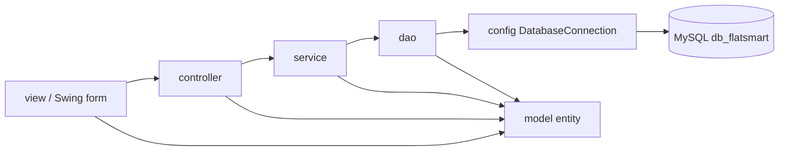

# Arsitektur FlatSmart: MVC, DAO Pattern, 4 Pilar OOP, dan Manajemen Koneksi

Proyek: Java Swing (form NetBeans) + MySQL `db_flatsmart`, dibangun dengan Maven (`pom.xml`, release 17).

## 1. Struktur proyek MVC

```
src/main/java
├── view        (M-V: seluruh layar, dibuat dengan NetBeans GUI Builder -> .form + initComponents)
├── controller  (C: 10 kelas, satu pintu bagi view ke lapisan bisnis)
├── service     (bisnis: validasi aturan, transaksi atomik, perhitungan)
├── dao         (DAO Pattern: seluruh SQL per tabel)
├── model       (entity/DTO: Produk, Promosi, Stok, Transaksi, DetailTransaksi, ...)
├── config      (DatabaseConnection: Singleton + connection pool)
└── util        (Format, Pemeriksa, Pesan, Sesi, GayaTabel, ExcelWriter, PilihTanggal)
```

Arah dependensi satu arah (view tidak pernah menyentuh JDBC/SQL):



| Lapisan | Contoh kelas | Tanggung jawab |
|---|---|---|
| View | `LoginFrame`, `KelolaProduk`, `TransaksiPenjualan`, `AnalisisPenjualan`, `FormProdukDialog`, `StrukDialog` | Menangkap input, merender tabel/grafik/struk. Tidak ada SQL, tidak ada aturan bisnis |
| Controller | `AuthController`, `ProdukController`, `PromosiController`, `PenjualanController`, `TagihanController`, `TransaksiController`, `AnalisisController`, `LaporanController` (+ `BasisController`, `CrudController`, `BacaController`) | Menerjemahkan aksi layar menjadi panggilan service, memvalidasi id, memilih modul mana yang dipakai |
| Service | `AuthService`, `ProdukService`, `PromosiService`, `PenjualanService`, `TagihanService`, `RiwayatService`, `AnalisisService`, `LaporanExportService` | Aturan bisnis + pembungkusan `DatabaseConnection.transaction` agar multi-tabel atomik |
| DAO | `PenggunaDAO`, `ProdukDAO`, `StokDAO`, `PromosiDAO`, `TransaksiDAO`, `LaporanDAO` | Satu DAO per tabel/kebutuhan query; pemilik tunggal kalimat SQL dan pemetaan `ResultSet` -> model |
| Model | `Produk`, `Promosi`, `Stok`, `Transaksi`, `DetailTransaksi`, `TagihanTransaksi`, `ItemKeranjang`, `Pengguna`, `BarisAnalisis`, `PenjualanProduk` | Data terbungkus (field `private` + getter/setter) |
| Config | `DatabaseConnection` | Singleton + kolam koneksi + eksekusi prepared statement |

Contoh satu rantai panggilan (hapus produk dari tabel `KelolaProduk`):

`KelolaProduk.btnHapus` → `Pesan` konfirmasi → `ProdukController.hapus(barcode)` → `ProdukService.hapus` →
`ProdukDAO.pernahDitransaksikan` → `ProdukDAO.hapus` → `DatabaseConnection.transaction` → SQL `DELETE stok` + `DELETE produk`.

## 2. DAO Pattern

- Setiap DAO hanya berisi SQL untuk tabelnya dan method dengan nama bahasa Indonesia (`cari`, `simpan`, `ubah`, `hapus`, `hitung...`).
- DAO tidak pernah membuka koneksi sendiri; semuanya lewat `DatabaseConnection.query/update/insertAmbilId/transaction`.
- Pemetaan baris ke model terpusat di method privat `petaHeader` / `petaDetail` (TransaksiDAO) sehingga perubahan skema cukup diedit satu kali.
- Query dinamis (filter kata kunci, rentang tanggal, jenis transaksi) dirakit dengan `StringBuilder` + parameter `?` — tidak ada konsolidasi string ke SQL, sehingga aman dari SQL injection.

## 3. Empat pilar OOP dan tempat penerapannya

| Pilar | Penerapan nyata di kode |
|---|---|
| **Encapsulation** | Seluruh field `model/*` `private` dengan getter/setter (`Produk.java`, `Promosi.java`, `Transaksi.java`). `DatabaseConnection` menyembunyikan URL/user/password dan `private DatabaseConnection()`. State sesi hanya lewat `Sesi.masuk/keluar/get/username`. Tiap controller menyimpan `private final XxxService service` sehingga view tidak bisa memanggil DAO langsung. |
| **Inheritance** | `ProdukController`, `PromosiController`, `TransaksiController`, `PenjualanController`, `TagihanController`, `AnalisisController`, `LaporanController`, `AuthController` semuanya `extends BasisController` (memakai ulang `modul()` dan `idWajib()`). `CrudController<T> extends BacaController<T>` (inheritance antarmuka). Semua layar `extends javax.swing.JDialog/JFrame` hasil GUI Builder, dan `PembayaranBerhasilDialog`/`StrukDialog` mewarisi perilaku jendela standar Swing. |
| **Polymorphism** | (a) Runtime: `CrudController<Produk> produkController = new ProdukController()` di `FormProdukDialog` — view memanggil `tambah/ubah/hapus` tanpa tahu kelas konkret. (b) Overload: `ProdukController.cari(String)` (satu data) dan `cari(String keyword, String filter)` (daftar) memakai nama sama dengan perilaku berbeda. (c) Polymorphic functional interface: `DatabaseConnection.query(sql, ps -> ...)` dan `transaction(() -> ...)` — lambda berbeda-beda di setiap DAO tetapi dipanggil lewat satu bentuk. (d) `AnalisisService`/`LaporanDAO` mengembalikan tipe koleksinya sendiri-sendiri tetapi dipakai view dengan pola yang sama. |
| **Abstraction** | `BacaController<T>` dan `CrudController<T>` mendefinisikan "apa" yang bisa dilakukan sebuah modul, bukan "bagaimana". `DatabaseConnection.SqlWork/PsWork/Binder` mengabstraksikan eksekusi JDBC. Service mengabstraksikan aturan bisnis (misal batch exp terdekat + diskon promo) sehingga view hanya memanggil satu method. |

## 4. CRUD terkoneksi database (tidak ada data hardcode)

| Modul | Create | Read | Update | Delete |
|---|---|---|---|---|
| Produk | `FormProdukDialog` → `ProdukController.tambah` (insert `produk` + batch pertama `stok`) | `KelolaProduk` (`cari` dengan keyword + filter stok), `TransaksiPenjualan` (saran produk) | `FormProdukDialog` mode ubah → `ubah` | `KelolaProduk` → `hapus` (ditolak bila riwayat transaksi menunjuk produk itu) |
| Promosi | `FormPromosiDialog` → `tambah` (insert `promosi` + kait `stok`) | `KelolaPromosi`, `PromosiDAO.cariAktifByStok` saat kasir memindai | `FormPromosiDialog` → `ubah` (lepas batch lama, pasang batch baru) | `KelolaPromosi` → `hapus` (melepas kaitan batch lebih dulu) |
| Transaksi | `PenjualanController.proses`, `TagihanController.proses` | `LihatTransaksi`, `AnalisisPenjualan`, `DetailPenjualanProdukDialog`, export Excel | tidak diubah by design (buku besar penjualan) | tidak dihapus by design (audit trail) |
| Stok batch | dibuat otomatis lewat `FormProdukDialog` | panel batch, `prioritasBatch` | `stokDAO.kurangi` saat penjualan, `pasangiPromosi/lepasPromosi` | ikut terhapus bersama produk dalam satu transaksi |
| Pengguna | (dikelola lewat dump DB) | login + `nama_kasir` di struk/riwayat | — | — |

Angka pada kartu ringkasan, tabel, grafik, dan struk semuanya hasil query — contoh nilai riil pada basis data saat ini: 18 produk, 16 promosi, 35 transaksi.

## 5. Nilai tambah: manajemen koneksi tingkat lanjut

`config/DatabaseConnection.java`

- **Singleton**: satu instance `POOL` bertipe `DatabaseConnection` dengan konstruktor `private`; hanya kelas ini yang tahu cara menghubungi MySQL (`instance()` sebagai titik akses).
- **Connection pooling**: kolam `ArrayDeque<Connection>` dengan batas `MAKS_KONEKSI = 5`. Koneksi fisik tidak ditutup oleh DAO; `close()` pada koneksi hasil `Proxy` (`Peminjam`) mengembalikan koneksi ke kolam. Sebelum dipakai kembali koneksi divalidasi `isValid(2)`, koneksi mati dibuang dan dihitung ulang.
- **Anti-blokir**: bila kolam penuh, thread menunggu maksimal 5 detik (`wait/notifyAll`); setelah itu dipakai koneksi lepas yang benar-benar ditutup, sehingga aplikasi tidak mungkin menggantung.
- **Transaksi per thread**: `ThreadLocal<Connection> TRANSAKSI` membuat semua query di dalam satu `transaction(...)` memakai koneksi yang sama, dengan `commit`/`rollback` otomatis.

Hasil uji (probe `UjiPool`, 12 thread x 20 kueri beruntun terhadap MySQL lokal):

| Skenario | Koneksi fisik yang terpakai |
|---|---|
| 30 kueri sekuensial | 1 (daur ulang dari kolam) |
| 480 kueri dari 12 thread paralel | 5 (tidak lebih dari batas kolam) |
| 20 kueri setelah badai paralel | 5 koneksi kolam, semuanya hasil reuse |

## 6. Catatan ORM (Hibernate/JPA)

ORM tidak dipasang sebagai dependensi karena (1) skema `db_flatsmart` berstatus final dan tidak boleh diubah, termasuk tidak boleh menambah file konfigurasi/persistence unit yang mengubah cara proyek dibangun, dan (2) proyek harus tetap berjalan dengan driver MySQL saja. Peran yang biasanya diisi ORM diambil alih secara manual oleh lapisan DAO:

| Tugas ORM | Padanan di FlatSmart |
|---|---|
| Entity mapping | kelas `model/*` + method `petaHeader`/`petaDetail` di DAO |
| CRUD otomatis | `simpan/ubah/hapus/cari` di tiap DAO, dibungkus `service` |
| Unit of work / transaction | `DatabaseConnection.transaction(SqlWork)` |
| Connection pool + session | `DatabaseConnection` (Singleton + kolam koneksi) |
| Dirty checking / cache | tidak dipakai; setiap layar memuat ulang data dari basis data agar angka selalu mutakhir |
