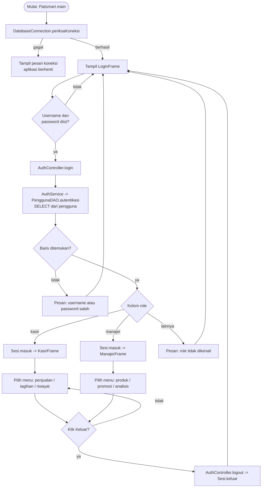
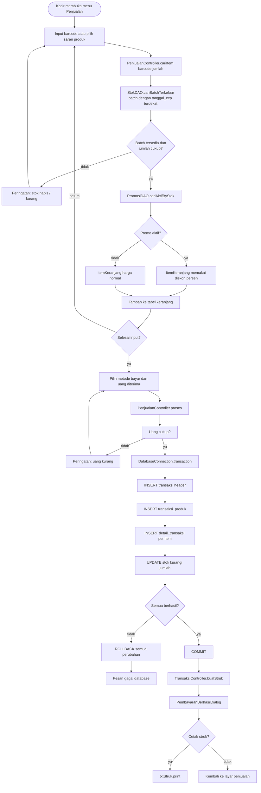
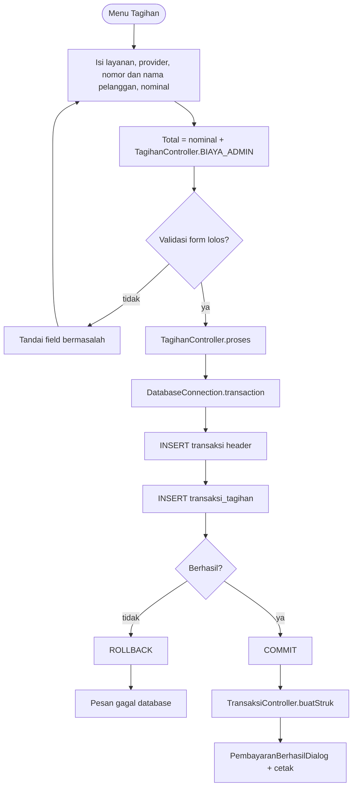
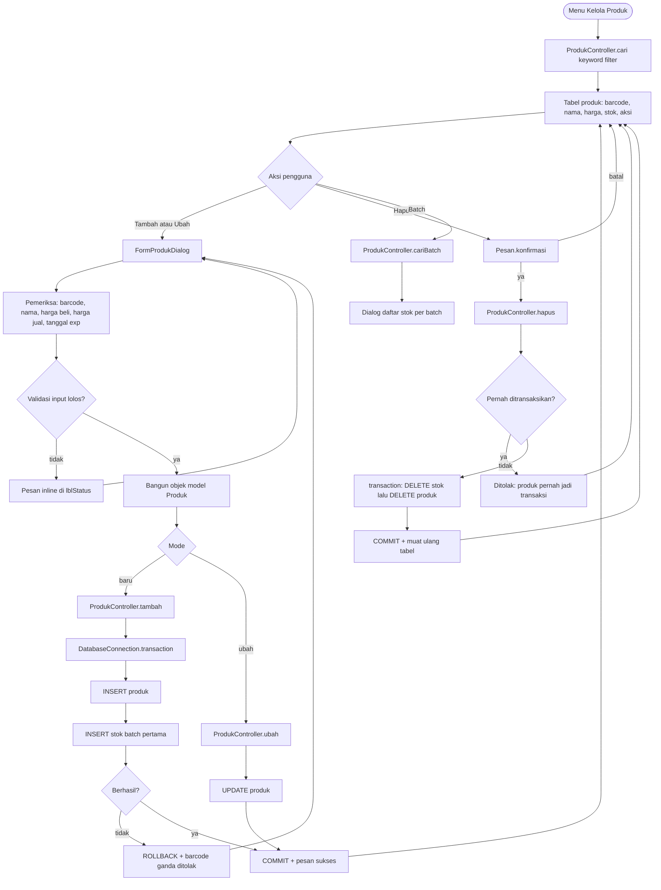
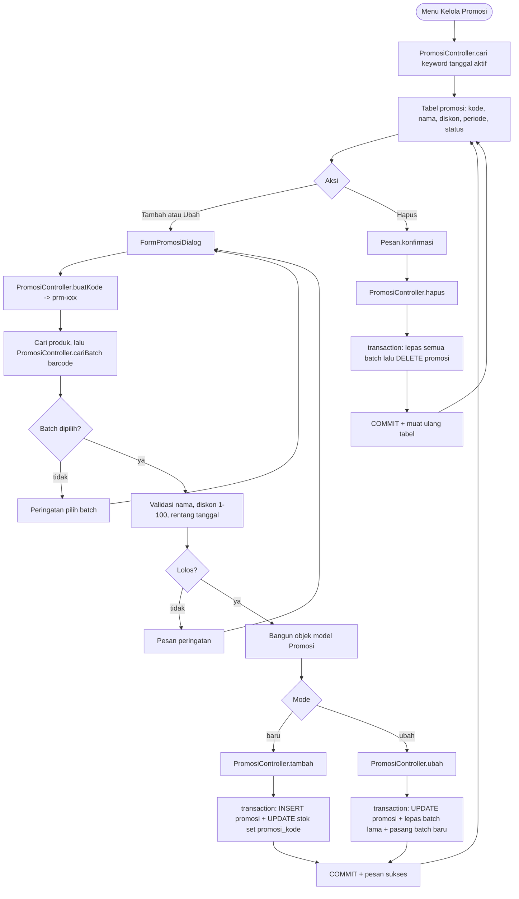
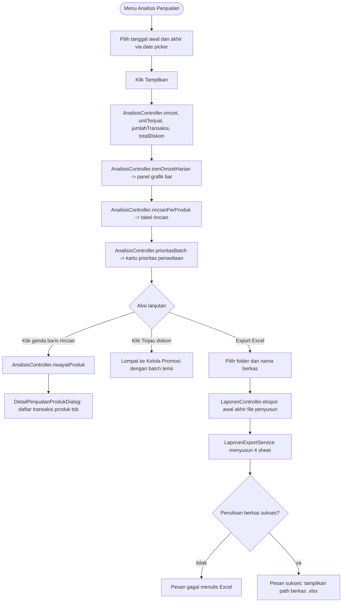

# Flowchart — FlatSmart

Seluruh diagram di bawah mengikuti alur kode nyata: `view` → `controller` → `service` → `dao` → MySQL.
Simpan sebagai `.mmd` atau render lewat VS Code / mermaid.live.

## 1. Alur utama aplikasi (login dan pemisahan role)

## 2. UC-03 Transaksi penjualan produk (kasir)

## 3. UC-04 Pembayaran tagihan (kasir)

## 4. UC-07 CRUD produk (manajer)

## 5. UC-08 CRUD promosi (manajer)

## 6. UC-10 dan UC-11 Analisis penjualan serta export

