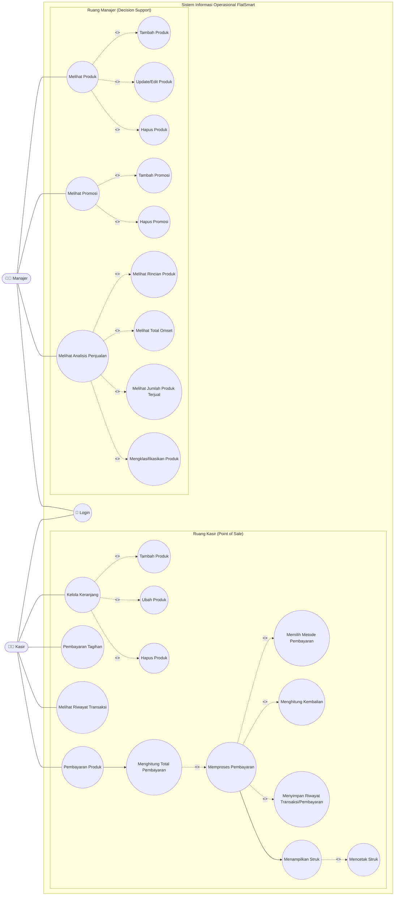

# Use Case Diagram — FlatSmart

Sistem: **FlatSmart: Sistem Informasi Operasional Minimarket**  
Referensi: **Laporan Project Akhir Praktikum Sistem Basis Data — Program Studi Sistem Informasi Universitas Mulawarman (2026)**

---

## 👥 Aktor Sistem

| Aktor | Peran & Ruang Lingkup |
|---|---|
| **Kasir** | Mengoperasikan modul Point of Sale (POS), mengelola keranjang belanja, memproses pembayaran (kalkulasi diskon, kembalian, struk thermal), melayani pembayaran tagihan (PPOB), dan meninjau riwayat transaksi kasir. |
| **Manajer** | Mengoperasikan modul back-office & Decision Support System (DSS), mengelola master produk dan stok batch, merancang promosi diskon bertarget, serta meninjau analisis performa penjualan (KPI, omzet harian, dan label kinerja produk). |

---

## 📊 Diagram Use Case (Gambar 2.8 Alur Use Case)

---

## 📝 Deskripsi Alur Use Case (Halaman 17-18 Laporan)

### 1. Alur Aktor Kasir
* **Login**: Kasir login untuk masuk ke dalam sistem dan mengakses ruang kerja kasir.
* **Pembayaran Produk**: Kasir melayani transaksi penjualan barang minimarket. Kasir mengelola belanja dengan menambah, mengubah, atau menghapus produk di keranjang.
* **Memproses Pembayaran**: Kasir memproses transaksi dengan menghitung total bayar, memilih metode bayar, menginput uang diterima, menghitung uang kembalian, menyimpan riwayat transaksi/pembayaran, serta menampilkan dan mencetak struk transaksi 40-kolom.
* **Pembayaran Tagihan**: Kasir memproses pembayaran tagihan pelanggan (listrik PLN, air PDAM, pulsa, dan BPJS) beserta biaya admin otomatis (Rp2.500).
* **Melihat Riwayat Transaksi**: Kasir dapat melihat dan memfilter transaksi yang pernah dilakukan sebelumnya.

### 2. Alur Aktor Manajer
* **Login**: Manajer login untuk mengakses fitur manajerial dan analitik.
* **Melihat Produk (CRUD)**: Manajer mengelola data produk dengan melihat daftar produk, menambah produk baru beserta batch stok awal dan tanggal expired, memperbarui data harga, serta menghapus produk.
* **Melihat Promosi (CRUD)**: Manajer mengelola promosi dengan melihat promosi aktif, membuat promosi baru berbasis diskon persen yang ditautkan ke batch stok tertentu, serta menghapus promosi.
* **Melihat Analisis Penjualan**: Manajer melakukan analisis penjualan periode tertentu dengan menghitung jumlah produk terjual, total omzet, melihat rincian performa per produk, dan mengklasifikasikan produk (`Terlaris`, `Normal`, `Lambat`) sebagai acuan penentuan strategi stok dan promosi.
